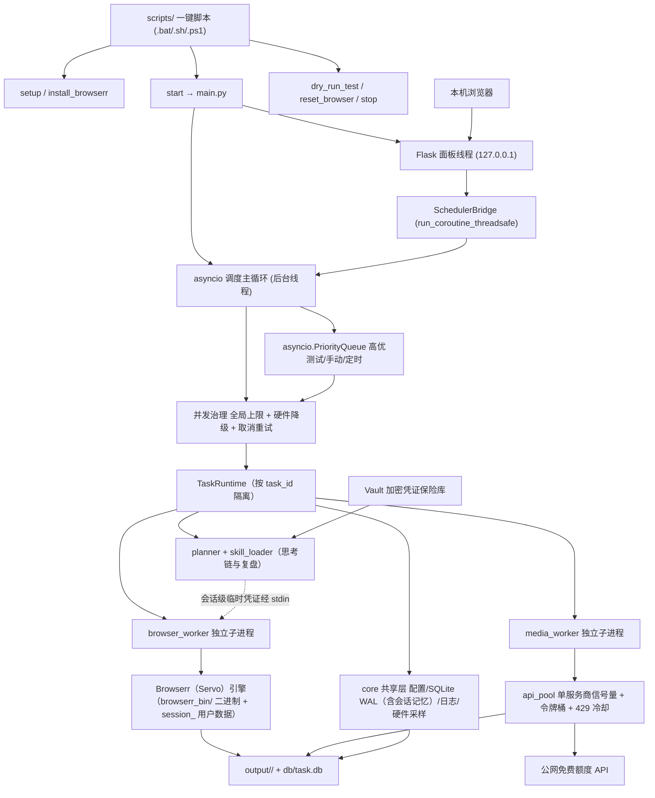

# 总体设计文档（system_design）

## 1. 设计目标

在 ThinkPad L430 这类老旧 Windows / Linux 设备上，以**纯 Python + 轻量进程隔离**实现一套本地自治 Agent：

1. 同时接收多条任务指令，按优先级并发执行，调度器本身永不阻塞等待业务子任务。
2. 浏览器自动化完全隔离于用户日常浏览器，凭证完全隔离于生成模型。
3. 聚合多家公网免费额度 API，自动规避限流，产出图片 / 视频并校验完整性。
4. 所有管理交互收敛到仅本机可访问的 Flask 面板。
5. 全局并发、单服务商并发、CPU / 内存阈值三重保护，防止弱硬件被跑满卡死。

## 2. 边界与不承诺项

| 边界 | 说明 |
| --- | --- |
| 不使用 Docker / 容器 | 隔离靠 `subprocess` 子进程、超时、进程树清理与独立目录，属于**轻量沙盒**，不是强安全边界 |
| 不接管系统浏览器 | 只使用安装到项目内 `browserr_bin/` 的 Browserr（Servo）引擎 二进制 + `browser_profile/session_<task_id>/` |
| 不硬编码密钥 | 所有 API Key 只在 `config.json`；vault 凭证只在 `vault/`；日志与面板脱敏 |
| 不硬编码绝对路径 | 全部路径相对项目根表达，由 `core/paths.py` 基于 `__file__` 动态解析；脚本按自身位置定位项目根；`BROWSERR_HOME` 安装时用相对路径 `browserr_bin`，运行时由 `setup_browserr_env()` 注入解析结果，Windows / Linux 通用 |
| 不公网暴露 | Flask 只绑定 `127.0.0.1`，非回环配置被强制改写 |
| 不承诺真实生成效果 | 无 Key 或显式 `dry_run` 时产出明确标注的模拟产物，不伪造视频 |
| Windows 内存上限 | 无 `RLIMIT_AS`，靠全局并发上限 + 硬件阈值降级 + Browserr 启动参数控制 |
| 免费额度 | 各家政策随时变化，以官方最新公告为准；代码只提供可配置适配器 |

## 3. 总体架构



### 3.1 进程 / 线程模型

| 单元 | 类型 | 职责 |
| --- | --- | --- |
| `main.py` 主线程 | 线程 | 运行 `werkzeug.make_server(...).serve_forever()`，可优雅关闭 |
| 调度 loop 线程 | 线程（`lm-scheduler`） | 持有 `asyncio` event loop，常驻 `_dispatch_loop` / `_hardware_loop` / `_schedule_loop` |
| 业务子任务 | `asyncio.Task` | 每个 task_id 一个，独立超时、独立重试、独立取消句柄 |
| 浏览器子进程 | `subprocess` | 每个浏览器任务一个独立 Python 进程，stdin 传参、stdout 回传 JSON |
| 生成子进程 | `subprocess` | 每个文生图 / 文生视频调用一个独立进程，含下载与校验 |
| 外部 HTTP | `to_thread` / 子进程 | 文本模型调用在线程池；生成调用在子进程，绝不阻塞调度 loop |
| Flask → loop | `SchedulerBridge` | `run_coroutine_threadsafe` 线程安全提交 / 取消 / 快照 |

### 3.2 为什么不用异步 Web 框架

保持 `flask` 单一 Web 依赖（依赖精简），用 bridge 跨越同步 WSGI 与异步调度 loop；
面板以 1–2 秒轮询读内存快照，不引入 WebSocket / 消息队列 / Celery 等额外组件。

## 4. 四大模块职责

### 4.1 板块 1 决策引擎（`agent_engine/` + `core/`）

- `task_queue.py`：优先级队列、常驻调度主循环、全局并发门禁、硬件降级、单任务取消、重试与状态持久化。
- `planner.py`：思考链（Skill + 历史 + 文本模型，失败降级模板）、按 task_id 独立复盘并写 `prompt_history`。
- `skill_loader.py`：`docs/skills/*.md` 的 CRUD、front-matter 解析、路径穿越防护。
- `task_loop.py`：单任务流水线编排与阶段进度上报。
- `core/`：配置热更新、SQLite WAL、带 task_id 的脱敏日志、硬件采样，四大板块单向依赖它。

### 4.2 板块 2 独立 Browserr + vault（`browser_agent/`）

- `vault.py`：独立凭证容器、受限权限、可选落盘加密、`engine_token` 鉴权、会话级临时凭证签发与销毁。
- `browser_runner.py`：**全项目唯一启动浏览器的位置**，`Driver(profile_dir=...)`。
- `sandbox_wrapper.py`：子进程隔离、stdin 传参、超时强杀进程树、退出码分类。
- `browser_worker.py`：子进程 CLI，凭证只注入隔离上下文，不落盘不记日志。

### 4.3 板块 3 图文视频 API 池（`media_generator/`）

- `api_pool.py`：按 `priority` 严格优先（`zen_gate_local` 为唯一启用源）+ 同档加权轮询、`Semaphore` 单源并发、令牌桶限速、429 冷却、消耗日志、请求构造。
- `image_gen.py` / `video_gen.py`：主进程选源与配额，子进程执行 HTTP / 下载 / 校验；支持参考图 data URL。
- `downloader.py`：流式 `.part` 原子落盘、魔数与大小校验、模拟产物生成。
- `media_worker.py`：生成子进程 CLI，兼容 URL / base64 / 异步任务轮询三种返回形态。

### 4.4 板块 4 Flask 面板（`web_panel/`）

五个页面（看板 / 配置 / Skill / API 源与会话 / 日志）+ 一组 JSON 接口；
所有动态内容经 `app.js` 转义后渲染，图片带 `onerror` 兜底；样式为本地 `static/app.css`（离线可用）。

## 5. 并发调度模型

### 5.1 队列

`asyncio.PriorityQueue` 元素为 `(priority, seq, TaskSpec)`：

| 优先级 | 值 | 来源 |
| --- | --- | --- |
| `HIGH_TEST` | 0 | 高优先级测试任务 |
| `MANUAL` | 1 | 面板手动触发 |
| `SCHEDULED` | 2 | 定时常规任务 |

`enqueue_mode = "insert"` 时有效优先级置为 `-1`（排到所有常规任务之前），组内仍按 `seq` FIFO；
`"queue"` 时按原优先级排队。`seq` 由 `itertools.count()` 统一分配，保证元素可比较且同优先级 FIFO。

### 5.2 调度主循环（只分发不等待）

```
while not stop:
    if degraded or len(active) >= max_concurrency: sleep(0.25); continue
    try: priority, seq, spec = queue.get_nowait()
    except QueueEmpty: sleep(0.25); continue
    if spec.task_id in cancelled: continue
    active[task_id] = TaskRuntime(spec, RUNNING, ...)
    handle = create_task(run_task(runtime))     # 立刻返回，绝不 await
    handles[task_id] = handle
    handle.add_done_callback(release_slot)
```

调度 loop 每轮耗时 O(1)，随时能接收新指令；业务 I/O 全在 `Task` / 子进程 / `to_thread` 中。

### 5.3 并发治理三层

| 层 | 机制 | 作用 |
| --- | --- | --- |
| 全局 | `len(active) < max_concurrency` 计数门禁 + 字典快照 | 控制整机并行度，便于面板查看与单独取消 |
| 服务商 | 每源独立 `asyncio.Semaphore(max_concurrency)` + 令牌桶 `rpm` | 防单源并发打爆触发 429 |
| 硬件 | 每 2 秒采样 CPU / 内存，带滞回的降级开关 | 超阈值只暂停派发新任务，现有任务继续跑完 |

429 时 `report_429()` 把该源置入冷却，`pick()` 自动跳过；重试退避 1s / 2s。

### 5.4 任务级隔离

| 维度 | 隔离方式 |
| --- | --- |
| 编号 | `uuid4().hex[:16]` 作为 task_id，全程日志 / DB / 目录带此标记 |
| 浏览器 | `browser_profile/session_<task_id>/` 独立用户数据目录 |
| 凭证 | `vault` 按 task_id 签发临时会话，任务结束 `revoke()` |
| 进程 | 每个浏览器 / 生成阶段独立 subprocess，PID 登记到 `_pids[task_id]` |
| 超时 | `asyncio.wait_for(execute(...), timeout_s)` + 子进程级超时 |
| 取消 | `cancel(task_id)` 只取消该句柄、杀该任务的进程树、销毁该会话 |
| 存储 | `tasks` 表按 task_id 主键 upsert，短事务 + WAL + `busy_timeout` |
| 复盘 | `planner.reflect` 只读本任务与同技能历史，互不共享中间变量 |

## 6. 状态流转

```
QUEUED ──派发──> RUNNING ──成功──> SUCCEEDED
   │                │
   │                ├──异常/超时──> RETRYING ──(最多 2 次)──> RUNNING
   │                │                    └──耗尽──> FAILED / TIMEOUT
   │                └──cancel()──> CANCELLED
   └──硬件降级──> 保持 QUEUED（面板标记 PAUSED，队列不丢任务）
```

终态统一在 `_on_task_done` 释放并发名额并落库；单个任务失败不会中断其他并行任务或调度主循环。

## 7. 数据流

1. 定时触发 / 面板提交 → `TaskSpec` → 优先级队列（DB 记 `QUEUED`）。
2. 调度主循环派发 → `TaskRuntime`（DB 记 `RUNNING`）。
3. `planner.build_plan`：Skill 正文 + `prompt_history` + 可选文本模型 → `plan`。
4. 需要网页时：决策引擎向 vault 申请临时凭证 → stdin → 浏览器子进程 → 隔离 Browserr → `materials`。
5. `plan.prompt` → `api_pool` 选源 / 配额 → 生成子进程 → HTTP → URL/base64/异步任务 → 下载校验 → `output/<task_id>/`。
6. 结果写 `tasks.result_json`；`planner.reflect` 写 `prompt_history`；日志带 task_id 进内存环形缓冲与文件。
7. 面板轮询 `/api/status`、`/api/tasks`、`/api/logs` 读内存快照与 SQLite。

## 8. 隔离方案汇总

| 对象 | 隔离手段 | 位置 |
| --- | --- | --- |
| Browserr 二进制 | 仅 `scripts/install_browserr.* 下载 Browserr 官方 release` 自带；安装时 `BROWSERR_HOME=browserr_bin` | 项目内 `browserr_bin/`（不入库） |
| Cookie / 缓存 / localStorage | 每任务独立 `user_data_dir` | `browser_profile/session_<task_id>/` |
| 登录凭证 | 独立容器 + 受限权限 + 可选加密 + 会话级临时句柄 | `vault/` |
| API Key | 只在 `config.json`，进程内读取，stdin 传子进程 | 不进日志 / 不进面板响应 |
| 子进程 | `CREATE_NEW_PROCESS_GROUP` / `start_new_session` + 进程树强杀 | 每任务独立 |
| 产物 | 按 task_id 分目录 + `.part` 原子落盘 | `output/<task_id>/` |
| 日志 | `contextvars` 注入 task_id + 脱敏过滤器 | `logs/` + 内存环形缓冲 |

## 9. 约束清单（实现必须遵守）

1. 禁止 Docker / 容器 / 虚拟机；只用标准库 `subprocess`。
2. 禁止 `channel`、`executable_path`、`connect_over_cdp` 等指向或连接系统浏览器的用法。
3. `media_generator` 全链路不得 import vault、不得读取原始凭证。
4. 面板只监听 `127.0.0.1`；`use_reloader=False`。
5. 依赖仅 `flask`、`browserr`、`requests`、`schedule`（`psutil` / `cryptography` 可选增强，缺失自动降级）。
6. 失败自动重试 2 次、超时强杀、单任务失败不影响其他任务。
7. 所有 API 密钥统一 `config.json`，代码零硬编码。
8. Web 面板是唯一交互入口，不做 GUI 桌面程序。
9. 复盘按 task_id 独立执行。
10. `scripts/` 与 `docs/` 入库；`browserr_bin/`、`vault/`、`browser_profile/`、`output/`、`logs/`、`db/*.db`、`.venv/` 不入库。
11. 全项目零硬编码绝对路径：路径一律相对项目根表达，由 `core/paths.py` 基于 `__file__` 动态解析；
    安装脚本只写相对路径 `BROWSERR_HOME=browserr_bin`，运行时由 `setup_browserr_env()` 注入解析结果。

## 10. 脚本层定位

`scripts/` 是外围入口层，只做环境准备、启动、自检、运维，**不参与运行时架构**：
`setup` 准备 venv 与项目内 `browserr_bin/` 的独立 Browserr；`start` 调 `main.py`；`dry_run_test` 调 `--dry-run-test`；
`reset_browser` 操作项目内会话目录；`stop` 校验 PID 命令行后停止服务。
Windows 用 `.bat` / `.ps1`，Linux / macOS 用 `.sh`，全部按脚本自身位置 `cd` 到项目根，无任何盘符路径。

## 11. 性能与可靠性权衡

- 入队 / 出队 O(log n)，分发 O(1)；SQLite 开 WAL + 短事务，面板读内存快照不压库。
- 日志内存环形缓冲上限 2000 条；WARNING 以上才写 DB 索引，避免高频写放大。
- 主要瓶颈是 Browserr 内存与视频长轮询，用默认并发 2、独立超时、取消句柄缓解。
- 配置原子写（`*.tmp` + `os.replace`）并热更新；外部调用全部强制超时。
- 退出时取消全部子任务、清理子进程树、删除 PID 文件。
