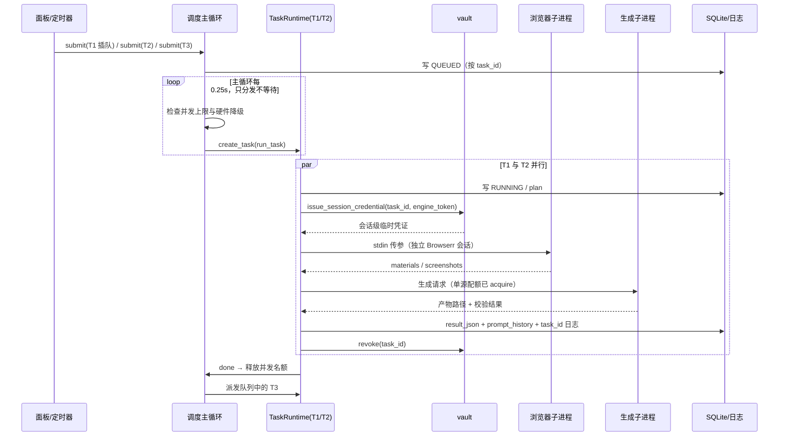

# 全链路工作流（workflow）

## 1. 任务生命周期

```
[定时触发 / 面板提交]
        │  TaskSpec.create()
        ▼
     QUEUED ──────────────── 硬件降级期间保持 QUEUED（面板标记 PAUSED）
        │  调度主循环：有空位 + 未降级 → get_nowait() → create_task()
        ▼
     RUNNING
        │  plan(10%) → browser(25%) → image(50%) → video(72%)
        │  → upload(86%, 可选) → persist(92%) → reflect(97%) → done(100%)
        ├──────────── 成功 ────────────► SUCCEEDED
        ├── 异常 / 超时 ─► RETRYING ──(retry ≤ 2)──► RUNNING
        │                    └── 重试耗尽 ─► FAILED / TIMEOUT
        └── cancel(task_id) ────────────► CANCELLED
                     │
                     ▼
        _on_task_done：释放并发名额、清理子进程与凭证会话、终态落库
```

每个阶段通过 `task_loop._report()` 同时更新 `TaskRuntime`、SQLite 与带 task_id 的日志。

## 2. 文字版时序（并发版本）

> 设同时到达三条指令：T1 高优先级测试（插队）、T2 面板手动、T3 定时常规。

1. **入队**：面板/定时器各调用 `Scheduler.submit()`，非阻塞立即返回 `task_id`。
   T1 有效优先级 `-1`，T2 为 `1`，T3 为 `2`；DB 各写一行 `QUEUED`。
2. **调度主循环**（常驻、只分发）：检查 `len(active) < max_concurrency` 且 `degraded == False`，
   `get_nowait()` 取 T1 → `create_task(run_task(T1))` → **立即 continue**，不等待 T1 跑完。
3. 循环下一轮，若还有空位（默认 2），取 T2 并分发；T3 暂留队列。
   此时调度 loop 依然每 0.25 秒醒一次，随时接收第 4、第 5 条指令。
4. **决策（各任务独立）**：`planner.build_plan()` 加载 `docs/skills/<skill>.md`、读同技能 `prompt_history`，
   有可用文本源则调用（失败降级模板），产出 `prompt / style / topic / steps / needs_browser`。
5. **凭证申请（仅需要网页时）**：决策引擎用进程内 `engine_token` 向 `vault` 申请
   `issue_session_credential(task_id, ...)`，得到只属于该 task_id 的临时凭证；
   `dry_run` 不申请任何真实凭证。
6. **浏览器子进程**：`sandbox_wrapper.run_worker("browser", payload, timeout)` 启动独立 Python 进程，
   payload（含临时凭证）经 **stdin** 传入；`browser_worker` 调用 `browser_runner.run_browser_job()`，
   使用项目内 `browserr_bin/` 的 Browserr（Servo）引擎 + `browser_profile/session_<task_id>/`，
   执行 goto / fill / click / extract / screenshot；二进制目录由 `paths.setup_browserr_env()` 在 import 前注入。
   结果经 stdout 一行 `LM_RESULT_JSON:{...}` 回传，PID 登记到 `_pids[task_id]`。
7. **生成（每阶段独立子进程）**：`image_gen.generate()` → `ApiPool.pick("image")` → `acquire()` 拿该源信号量与令牌 →
   `build_generation_request()` → `run_worker("media", ...)` 子进程发请求 / 下载 / 校验 → `release()`。
   `video_gen.generate()` 同理，并把上一步图片作为 `first_frame_image` 参考图（本地文件转 data URL）。
8. **可选上传**：`upload.enabled` 默认 false，只记录 `skipped` 原因，不做任何外联。
9. **落库与复盘**：结果写 `tasks.result_json`（按 task_id），`planner.reflect()` 读本任务与同技能历史，
   写 `prompt_history`；日志带 task_id 写入内存环形缓冲与文件，WARNING 以上写 `log_index`。
10. **释放名额**：T1 完成 → `SUCCEEDED` → `_on_task_done` 从 `active` 移除、清理进程与凭证会话 →
    队列里下一个任务自动被主循环取出；T2 崩溃/超时只影响自己，重试 2 次后按 `FAILED` 落库，
    T1 与调度器全程不受影响。

### Mermaid 时序图



## 3. 并发任务流转逻辑

### 3.1 指令来源

| 来源 | 优先级 | 默认入队方式 | 触发方式 |
| --- | --- | --- | --- |
| 高优先级测试任务 | `HIGH_TEST=0` | `insert`（可配置） | 面板「一键测试」/ 批量提交选高优先级 |
| 面板手动任务 | `MANUAL=1` | `config.scheduler.manual_enqueue_mode`（默认 `queue`） | 面板「提交并行任务」 |
| 定时常规任务 | `SCHEDULED=2` | `queue` | `schedule` 每 `interval_seconds` 触发一次，受 `daily_task_limit` 限制 |

### 3.2 并发判定

```
可派发 = (not degraded) and (len(active) < max_concurrency) and queue 非空
```

- `active` 是 `dict[task_id, TaskRuntime]`，用 `threading.RLock` 保护，面板读快照不遍历事件循环内部。
- 硬件降级只暂停「从队列取新任务」，**不取消、不杀死**任何运行中任务；资源回落到
  `阈值 - recovery_margin` 以下自动恢复。
- 单服务商配额在 `ApiPool.acquire()` 内等待，等待发生在业务子任务里，不占用调度主循环。

### 3.3 取消（单独终止）

```
cancel(task_id):
  _cancelled.add(task_id); _queued.pop(task_id)
  _kill_pids(task_id)            # taskkill /T /F 或 killpg
  vault.revoke(task_id)
  handles[task_id].cancel()
  DB 写 CANCELLED
```

其它 `task_id` 的句柄、进程、凭证、数据库行完全不动；调度主循环继续接收新指令。

## 4. 失败、超时与重试

| 情况 | 处理 |
| --- | --- |
| 子进程崩溃 / 非零退出 | `sandbox_wrapper` 返回 `ok=False` → 业务子任务抛错 → Scheduler 捕获 |
| 子进程超时 | `wait_for(communicate)` 超时 → 强杀进程树 → 返回 `timeout=True` |
| 单任务总超时 | `asyncio.wait_for(execute, timeout_s)` → 状态 `TIMEOUT` |
| HTTP 429 | `report_429` 冷却该源，`pick` 绕过；当前任务进入重试 |
| 下载不完整 | `verify()` 魔数/大小不通过 → 删除半成品 → 重试 |
| 重试策略 | 最多 2 次（`retry_times`），退避 `1s / 2s`，每次 `DB` 记 `RETRYING` 与 `retry` 次数 |
| 最终失败 | `FAILED` / `TIMEOUT` + `error` 字段入库，日志带 task_id；**不影响其他并发任务** |

## 5. 硬件降级路径

```
_hardware_loop 每 2s:
  data = await to_thread(hardware.update())     # psutil 可选，否则 /proc 或 ctypes
  degraded = 滞回判定（超阈值进入，回落到 阈值-滞回 才恢复）
  config.reload_if_changed()                   # 面板改配置热更新
  if degraded: _dispatch_loop 暂停 get_nowait，队列保留
```

降级期间面板底部状态条与顶部徽标显示「硬件降级：暂停派发新任务」。

## 6. 凭证流转（严格单向）

```
vault/cards.json（受限权限，可选加密）
   └─ 决策引擎 issue_session_credential(task_id, engine_token)  [内存]
        └─ stdin → browser_worker（独立子进程）
             └─ context.add_cookies / set_extra_http_headers / add_init_script
                  └─ 仅注入 browser_profile/session_<task_id>/ 的隔离 Browserr
   ✗ 不进入 media_generator、不进入 API 请求体、不进入 prompt、不进日志、不进面板响应
任务结束 → vault.revoke(task_id) 清空该会话
```

## 7. 脚本调用链

```
setup.bat/sh        → cd 到脚本上一级（项目根）；python -m venv / pip install -r requirements.txt
                     → 设 BROWSERR_HOME=browserr_bin（相对项目根）
                     → python -m scripts/install_browserr.* 下载 Browserr 官方 release（二进制落到项目内 browserr_bin/）
                     → python main.py --setup-check
start.bat/sh/ps1    → python main.py [--host/--port]（运行时由 paths.setup_browserr_env() 注入浏览器目录）
dry_run_test.*      → python main.py --dry-run-test --dry-run-count 3
install_browserr.*  → 同上，只重下/修复 browserr_bin/ 内的 Browserr
reset_browser.*     → 删除 browser_profile/session_*（二次确认）
stop.*              → 读 logs/local_muse.pid → 校验命令行含 main.py → 终止
```

## 8. 数据落库点

| 时机 | 表 | 内容 |
| --- | --- | --- |
| 入队 | `tasks` | task_id / priority / source / skill / instruction / status=queued / dry_run |
| 派发与每阶段上报 | `tasks` | status / stage / progress / retry / pid / provider / simulated |
| 完成 | `tasks` | result_json（产物路径、素材、计划摘要、复盘）/ finished_at |
| 每次 API 调用 | `api_usage` | provider / kind / task_id / status / latency_ms / note |
| 复盘 | `prompt_history` | task_id / skill / prompt / reflection / score |
| 对话发送 | `conversations` / `messages` | 会话标题、用户指令、任务回执与收尾消息（按 conversation_id 关联） |
| 入队 | `tasks.conversation_id` | 归属会话，供右侧「当前执行」按会话过滤 |
| WARNING 以上日志 | `log_index` | ts / level / task_id / stage / message（已脱敏） |

## 9. 定时任务的每日上限

`_enqueue_scheduled()` 每次触发前调用 `db.count_today("scheduled")`，达到 `daily_task_limit` 即跳过本轮，
并在日志留痕；面板手动与高优先级测试任务**不受每日上限限制**，可随时插队。
